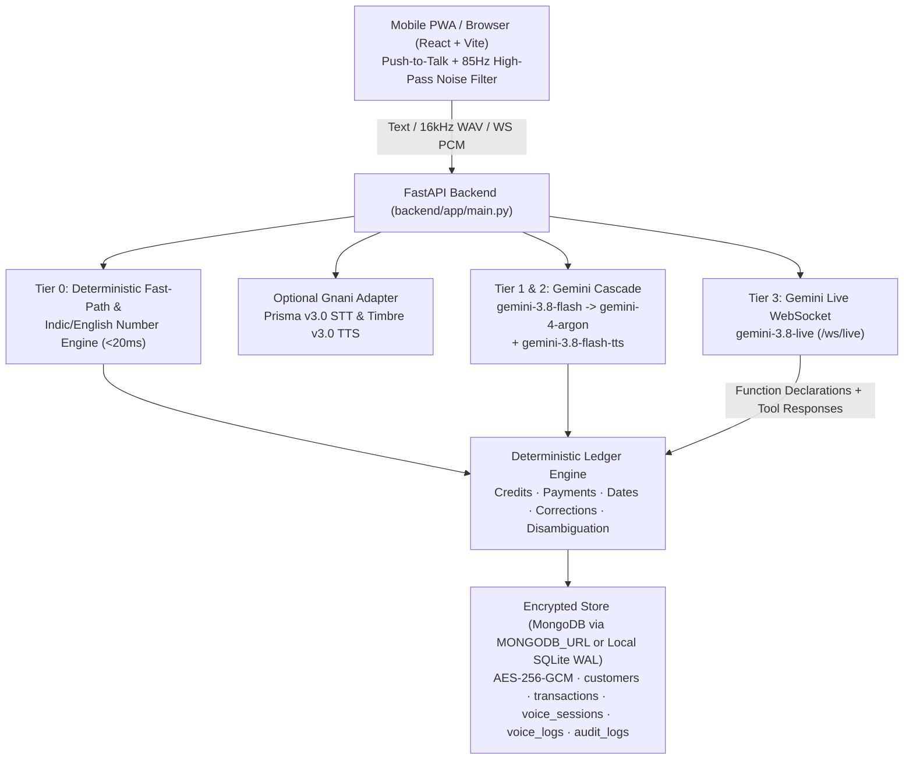

# Voice Khata — Multilingual AI Voice Ledger for Kirana Stores (PS2)

> **Voice-first digital khata (udhaar ledger)** built for noisy Indian kirana shops. Optimized with a **3-tier cascaded Gemini AI pipeline** via the modern **Interactions API** (`gemini-3.8-flash` → `gemini-4-argon` / `gemini-4-carbon` + `gemini-3.8-live` + `gemini-3.8-flash-lite-tts`), deterministic sub-20ms fast-path parsing, and a pluggable **Gnani AI (`gnani-vachana` Prisma STT & Timbre TTS)** adapter.

---

## Key Highlights & Sub-2s Optimization

1. **Tier 0 Deterministic Fast-Path (`< 20 ms`)**:
   - Handles spoken ledger queries (`"Aaj kitna udhaar gaya?"`, `"Suresh ka total batao"`, `"Sabse zyada udhaar kiske paas hai?"`), clean transactions, corrections (`"Nahi, 430"`), and disambiguation replies locally before invoking any LLM.
   - Full Indic + English spoken number normalizer (`"teen sau chaalis"` → `340`, `"three-forty"` → `340`, `"chaar sau tees"` → `430`, `"muunnooru nalavattu"` → `340`, `"ek hazaar do sau pachaas"` → `1250`).
2. **Tier 1 Interactions API Audio + Structured JSON (`gemini-3.8-flash`, `thinking_level="low"`)**:
   - Uses `client.interactions.create(..., store=False)` with inline 16kHz noise-filtered WAV audio and `response_format` JSON Schema, extracting multi-clause code-mixed transactions (`"Ramesh ka 340 udhaar, kal 200 diya tha"`) with zero intermediate STT hop.
3. **Tier 2 Precision Escalation (`gemini-4-argon` / `gemini-4-carbon`, `thinking_level="medium"`)**:
   - Automatically escalates to `gemini-4-argon` when acoustic noise lowers confidence (`< 0.80`) or transaction direction is ambiguous (`"Ramesh ko 300 dena hai"` vs `"Ramesh ne 300 diya"`), with `gemini-4-carbon` selectable for maximum reasoning accuracy.
4. **Tier 3 Real-Time Bidirectional Voice (`/ws/live`, `gemini-3.8-live`)**:
   - Streams 16kHz PCM mic input to Gemini Live with `input_audio_transcription`, `output_audio_transcription`, barge-in `interrupted` handling, and 24kHz PCM voice replies while enforcing that **every ledger read/write runs through deterministic Python ledger tool calls**.
5. **Gnani AI Platform Services (`gnani-vachana` adapter)**:
   - Supports **Gnani Prisma STT (`prisma-v3.0`)** and **Gnani Timbre TTS (`timbre-v3.0`)** via `GNANI_API_KEY` and `SPEECH_PROVIDER=gnani` (or `auto`).
6. **Bulletproof Ledger Brain**:
   - Exact formula: `Outstanding = SUM(confirmed credits) - SUM(confirmed payments)` (never estimated by an LLM).
   - Relative date resolution (`aaj`, `kal`, `parso`, `ivattu`, `ninne`) stored as exact ISO `YYYY-MM-DD` dates.
   - Auditable spoken corrections (`"Nahi, 430"`) updating pending or last committed session transactions via `audit_logs` without double-counting.
   - Duplicate customer disambiguation (`"Kaunse Ramesh? Ramesh Kumar ya Ramesh Gowda?"`).

---

## Architecture Diagram



---

## Responsible AI & DPDP Act Compliance

| Guardrail | Implementation |
| --- | --- |
| **First-turn AI disclosure** | `LedgerEngine` & Gemini Live system instructions announce AI identity on turn 0 in the user's selected language (`hi-IN`, `kn-IN`, `ta-IN`, `te-IN`, `en-IN`). |
| **Data & DPDP Act** | Synthetic demo seed data only (`is_synthetic=1`); phone numbers, transcripts, and AI replies are encrypted at rest with **AES-256-GCM** (`FieldCipher`). |
| **Transcript deletion** | Ephemeral mode toggle + 1-click **Wipe Demo Transcripts** button (`DELETE /api/privacy/transcripts`). |
| **Money & Reminders** | Zero lending/credit advice. Payment reminders strictly require `reminder_opt_in = true` (403 otherwise) and pass a pressure/threat guardrail regex. |
| **Secrets & Voices** | `.env` excluded in `.gitignore`. Uses prebuilt synthetic voices (`Puck`, Gnani `Nalini`, or browser speech) — never clones real voices. |

---

## Setup Instructions

### 1. Configure Environment Secrets & Database
```bash
cp .env.example .env
# Edit .env and add your GEMINI_API_KEY (optional GNANI_API_KEY)
# To use MongoDB, set MONGODB_URL=mongodb+srv://... (leave blank for local SQLite)
```

### 2. Run Backend (Python 3.11+ & FastAPI)
```bash
cd backend
python -m venv .venv
# Windows PowerShell: .venv\Scripts\Activate.ps1
# macOS/Linux: source .venv/bin/activate
python -m pip install -r requirements.txt
# Optional for Gnani Prisma/Timbre SDK:
# python -m pip install gnani-vachana
python -m uvicorn app.main:app --reload --port 8000
```

Run backend tests:
```bash
cd backend
python -m pytest -v
```

### 3. Run Frontend PWA (React + Vite)
```bash
cd frontend
npm install
npm run dev
```
Open `http://localhost:5173`. Run frontend unit tests and production build check:
```bash
cd frontend
npm test
npm run build
```

---

## Judge Demo Test Scenarios (Pre-Seeded Synthetic Store)

1. `"Suresh ka 340 udhaar"` → Records ₹340 credit + updates balance + speaks AI disclosure on turn 1.
2. `"Suresh ne 200 diya"` → Records ₹200 payment + reduces balance.
3. `"Suresh ka teen sau chaalis udhaar"` / `"three-forty"` → Normalizes spoken number to ₹340.
4. `"Nahi, 430"` → Corrects previous entry to ₹430 in place with `audit_logs` entry (no duplicate ₹430 row).
5. `"Ramesh ka 300 udhaar"` → Asks `"Kaunse Ramesh? Ramesh Kumar ya Ramesh Gowda?"`; reply `"Ramesh Gowda"` commits cleanly.
6. `"Suresh ka 340 udhaar, kal 200 diya tha"` → Atomically records today's ₹340 credit + yesterday's ₹200 payment.
7. `"Aaj kitna udhaar gaya?"` / `"Suresh ka total batao"` → Answers verbally in `< 2s`.

